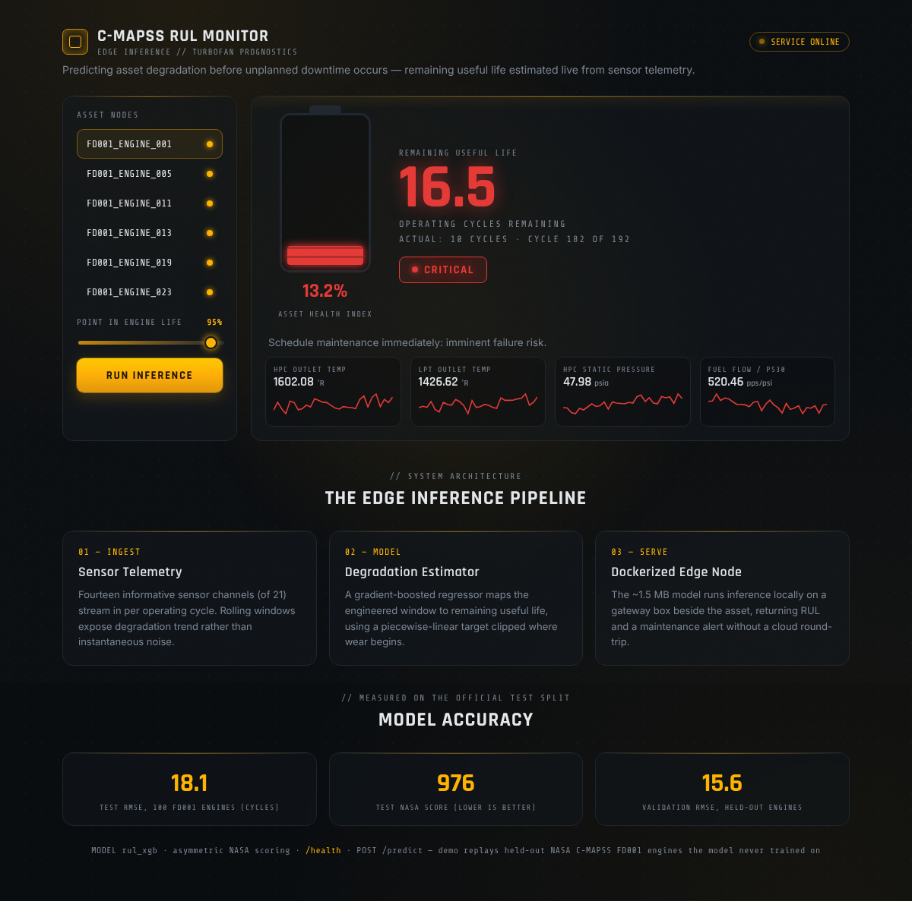
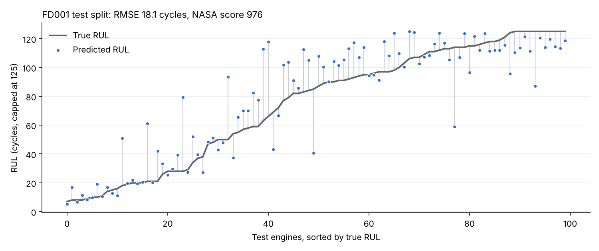

# Predictive Maintenance: Remaining Useful Life (RUL) Estimation for Turbofan Engines

Estimates the **Remaining Useful Life** of turbofan engines from time-series sensor data, moving
maintenance from *reactive* (fix after failure) and *scheduled* (fix on a fixed calendar, wasting
healthy component life) to **condition-based**: service each unit when its measured degradation
warrants it. The repo has three parts: an XGBoost RUL model, a small edge-inference service, and a
LangGraph "Maintenance Copilot" that combines the model with retrieval over maintenance manuals.

**Live demo:** https://predictive-maintenance-remaining-useful-ji0m.onrender.com/ (free Render
instance, so the first load can take a minute)



## Results

Trained and evaluated on the real NASA C-MAPSS FD001 data. The test score uses the last recorded
cycle of each of the 100 official test engines, with true RUL capped at 125 like the training labels.

| Model | Test RMSE (cycles) | Test NASA score (lower is better) |
| --- | --- | --- |
| XGBoost (this repo) | **18.1** | **976** |
| Baseline: predict the training-mean RUL for every engine | 42.0 | 33,781 |

Validation RMSE on 20 held-out training engines (all cycles): 15.6. Training is deterministic, so
`python src/train.py` reproduces these numbers exactly.



## Dataset

NASA **C-MAPSS Turbofan Degradation** (subset FD001). Each engine runs from healthy operation to
failure while 21 sensors and 3 operating settings are logged per cycle. The label is RUL: the
number of cycles remaining until failure.

The real FD001 files (`train_FD001.txt`, `test_FD001.txt`, `RUL_FD001.txt`) are included in
`data/`, from the [NASA Prognostics Data Repository](https://www.nasa.gov/intelligent-systems-division/discovery-and-systems-health/pcoe/pcoe-data-set-repository/)
(A. Saxena and K. Goebel, 2008, "Turbofan Engine Degradation Simulation Data Set").
`data/CMAPSS_readme.txt` is NASA's original description.

`src/make_synthetic_data.py` can also generate data in the same format for quick experiments and
tests. It writes to `data/synthetic/` and never overwrites the real files.

## Approach

1. **RUL labelling.** Piecewise-linear target clipped at 125 cycles (an engine is treated as
   as-good-as-new until wear begins; the standard C-MAPSS treatment).
2. **Sensor selection.** The 7 sensors that are constant (or take only two values) in FD001 are
   dropped, leaving the usual 14.
3. **Degradation features.** Per-engine rolling mean and standard deviation (windows of 5 and 15
   cycles) to expose sensor drift, plus each reading's deviation from a fleet-wide healthy
   baseline (the mean of the first 20 cycles of every training engine) to capture cumulative wear.
   Windows are grouped per unit so no signal leaks across engines. Every feature depends only on
   past readings and fixed training statistics, so the service gives the same answer for the last
   15+ cycles of an engine as for its full history.
4. **Model.** XGBoost regressor with early stopping on engines held out by unit: a strong tabular
   baseline that trains in under a minute and exports to a ~1.5 MB artifact suited to edge
   inference.
5. **Evaluation.** RMSE (in cycles) and the **NASA asymmetric score**: each engine costs
   `exp(-d/13) - 1` if the prediction is early and `exp(d/10) - 1` if it is late (`d` = predicted
   minus true), so a late prediction, which risks an unplanned outage, costs more than an equally
   early one.

## Quick start (RUL model)

```bash
pip install -r requirements.txt
cd src
python train.py                 # trains on data/, saves model + metrics to models/
python evaluate.py              # official test split: RMSE and NASA score, plus a baseline
```

To try the synthetic data instead: `python make_synthetic_data.py && RUL_DATA_DIR=../data/synthetic
RUL_MODEL_DIR=/tmp/rul-model python train.py` (the second variable keeps the real model intact).

## Tests

```bash
pip install -r requirements-dev.txt
python -m pytest -q
```

The tests cover RUL labelling, feature leakage between engines, the short-window regression, input
validation in the service, a full synthetic training run (including that training is
reproducible), and the copilot tools and agent loop with a scripted fake LLM. GitHub Actions runs
them on every push and pull request, and also builds and smoke-tests the Docker image.

## Edge inference service

A single-file Flask app loads the model once and serves RUL predictions with a tiered maintenance
alert: CRITICAL at 20 cycles or less, WARNING at 50 or less, otherwise OK. The small footprint
simulates a gateway box running inference next to the machinery instead of streaming raw sensor
data to the cloud. The dashboard at `/` replays held-out FD001 engines the model never trained
on and shows the prediction next to the true RUL.

```bash
python service/app.py           # development server on :8000
curl localhost:8000/health      # lists required_sensors and min_cycles, plus test metrics
```

`POST /predict` takes at least 15 consecutive cycles, oldest first. Every cycle must include all
14 sensors listed in `required_sensors`; missing or non-numeric readings get a 400 with a message
saying what is wrong.

```bash
curl -X POST localhost:8000/predict -H "Content-Type: application/json" -d '{
  "unit_id": 7,
  "cycles": [
    {"sensor_2": 642.5, "sensor_3": 1590.1, "sensor_4": 1408.2, "sensor_7": 553.3,
     "sensor_8": 2388.1, "sensor_9": 9052.4, "sensor_11": 47.5, "sensor_12": 521.6,
     "sensor_13": 2388.1, "sensor_14": 8133.9, "sensor_15": 8.42, "sensor_17": 393,
     "sensor_20": 38.9, "sensor_21": 23.3},
    ...
  ]}'
# -> {"predicted_rul_cycles": 42.0, "health_index": 33.6, "alert": "WARNING", ...}
```

Containerized (gunicorn, serves the committed model; Render sets `$PORT`):

```bash
docker build -t rul-edge .
docker run -p 8000:8000 rul-edge
```

## Maintenance Copilot

An agent that answers questions about engine health by combining the trained RUL model with
retrieval over maintenance manuals and an optional Engine → Sensor → FailureMode knowledge graph.

### Architecture

```
                 ┌──────────────────────────────┐
question  ─────▶ │   LangGraph state graph        │
                 │                                │
                 │   START → agent → tools →┐     │
                 │             ▲────────────┘     │
                 │             └──────────→ END   │
                 └──────┬─────────────┬───────────┘
                        │             │
           tool node dispatches to:   │
     ┌──────────────────┼─────────────┼───────────────────┐
     ▼                  ▼             ▼                    ▼
predict_rul       search_manuals   failure_modes    (LLM reasoning)
XGBoost RUL       Chroma + local   Neo4j graph
model (tool)      embeddings (RAG) (optional)
```

- The **agent node** calls the configured LLM with the tool schemas; the model decides whether to
  answer or call a tool.
- The **tools node** executes the requested tools and feeds the results back.
- A conditional edge loops agent ↔ tools until the model produces a final answer.

### Tools

| Tool             | Backed by                                           | Use                                         |
| ---------------- | --------------------------------------------------- | ------------------------------------------- |
| `predict_rul`    | trained XGBoost model (`models/`)                   | estimate RUL and alert from a sensor window |
| `search_manuals` | Chroma vector store + `all-MiniLM-L6-v2` embeddings | retrieve guidance from manuals              |
| `failure_modes`  | Neo4j (optional; static-map fallback)               | map a sensor to failure modes + mitigations |

### Setup

```bash
pip install -r copilot/requirements.txt

export ANTHROPIC_API_KEY=<your key>     # optional; or GEMINI_API_KEY / OPENAI_API_KEY
python -m copilot.rag                   # index the manuals in copilot/manuals/
uvicorn copilot.api:app --host 0.0.0.0 --port 8100
```

The first key found is used, in the order Anthropic, Gemini, OpenAI. `COPILOT_MODEL` overrides
the default model for that provider. Without any key the agent runs in **retrieval-only mode**:
it still answers from the manuals via RAG, so the system is runnable end to end before you add a
key. If a tool call fails (for example the LLM sends incomplete sensor data), the error goes back
to the LLM so it can recover, and the agent is capped at 12 steps per question.

### Endpoints

```bash
curl -X POST http://localhost:8100/ask \
  -H "Content-Type: application/json" \
  -d '{"question": "Engine 3 shows rising HPC temperature and fuel flow. What failure mode is this and what should I do?"}'

# same input rules as the edge service: 15+ cycles with all 14 required sensors
curl -X POST http://localhost:8100/predict_rul \
  -H "Content-Type: application/json" \
  -d @cycles.json

curl -X POST http://localhost:8100/reindex

curl http://localhost:8100/health
```

### Optional: Neo4j knowledge graph

```bash
export ANTHROPIC_API_KEY=<your key>     # optional
export NEO4J_PASSWORD=<choose one>      # required
docker compose -f copilot/docker-compose.yml up --build
docker compose -f copilot/docker-compose.yml exec copilot python -m copilot.graph_kg   # seed
```

Seeding only replaces `Engine`, `Sensor` and `FailureMode` nodes; other data in the database is
left alone. If `NEO4J_URI` or `NEO4J_PASSWORD` is unset, or the database is unreachable,
`failure_modes` falls back to a built-in sensor → failure-mode map, so nothing breaks. The tool
accepts physical names (`fan_speed`) and C-MAPSS columns (`sensor_8`).

### Adding your own manuals

Drop `.pdf`, `.md` or `.txt` files into `copilot/manuals/`, then run `python -m copilot.rag` (or
`POST /reindex`). PDFs are parsed with `pypdf`.

## Project layout

```
Predictive-Maintenance-Remaining-Useful-Life-Estimation/
├── data/                     NASA C-MAPSS FD001 files
├── docs/                     README images
├── src/
│   ├── data_prep.py          load, RUL labels, feature engineering
│   ├── train.py              XGBoost training + metrics
│   ├── evaluate.py           official test-split evaluation
│   ├── inference.py          input validation + prediction, shared by service and copilot
│   ├── metrics.py            RMSE and NASA score
│   ├── plot_results.py       predicted vs true RUL chart
│   └── make_synthetic_data.py
├── models/                   trained model + metadata (incl. test metrics)
├── service/app.py            Flask edge-inference API + dashboard
├── tests/                    pytest suite
├── copilot/
│   ├── agent.py              LangGraph agent
│   ├── api.py                FastAPI endpoints
│   ├── rag.py                manual indexing + retrieval (Chroma)
│   ├── graph_kg.py           Neo4j knowledge graph
│   ├── manuals/              source documents
│   ├── requirements.txt
│   ├── Dockerfile
│   └── docker-compose.yml    copilot + Neo4j
├── Dockerfile                edge-inference image
├── requirements.txt          RUL model + edge service dependencies
└── requirements-dev.txt      + test and plotting dependencies
```

## Extending

- Add FD002 to FD004 (multiple operating conditions and fault modes).
- Swap in an LSTM or 1D-CNN sequence model and compare against the XGBoost baseline.
- Add a dashboard plotting predicted RUL and alert history per unit.

## License

MIT, see [LICENSE](LICENSE). The C-MAPSS data is published by NASA.
